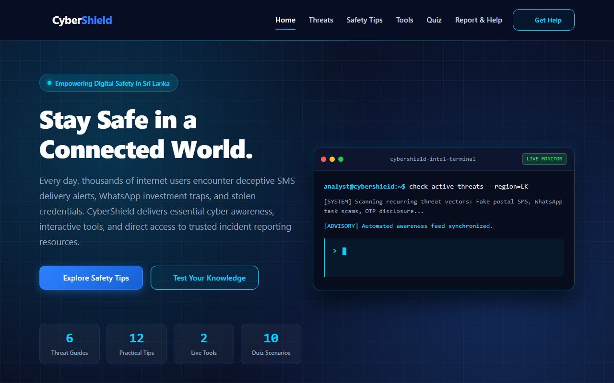
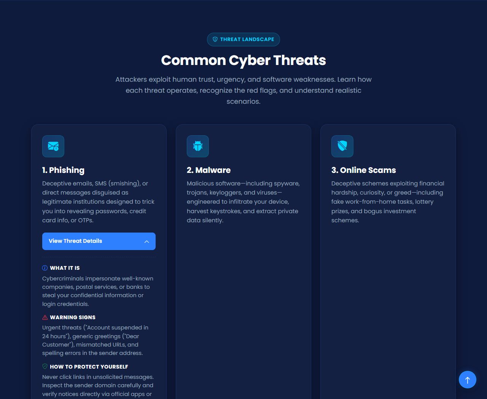
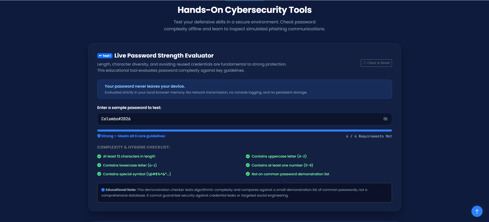
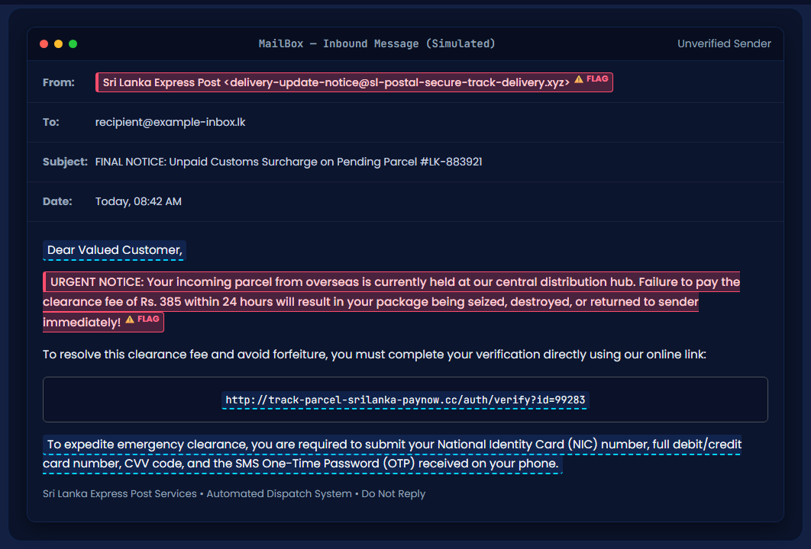
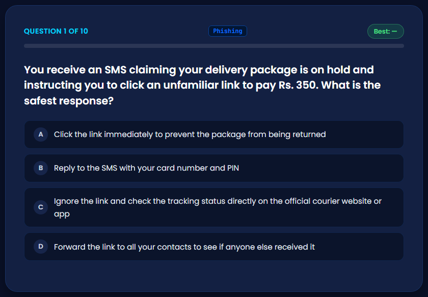
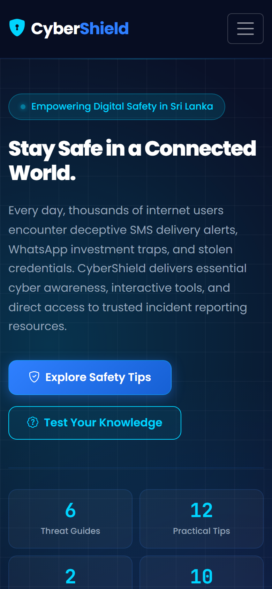

# CyberShield — Cybersecurity Awareness Website

CyberShield is a responsive, client-side educational frontend website designed to empower internet users in Sri Lanka and globally with practical cyber safety habits. Built with semantic HTML5, custom CSS3, Bootstrap 5.3.3, and jQuery 3.7.1, CyberShield demystifies common online threats, provides hands-on interactive tools for evaluating passwords and detecting phishing emails, tests knowledge through a 10-question scenario quiz, and connects users to verified national incident-reporting resources.

---

## Live Demo & Source Code

- **Live Website:** (https://jumaila-junaid.github.io/CyberShield/)
- **Source Code:** [https://github.com/jumaila-junaid/CyberShield](https://github.com/jumaila-junaid/CyberShield)

---

## Developer Profiles

Designed and developed by **Jumaila Junaid**:
- **GitHub:** [https://github.com/jumaila-junaid](https://github.com/jumaila-junaid)
- **Portfolio:** [https://jumaila-junaid.github.io/Jumaila-Portfolio/](https://jumaila-junaid.github.io/Jumaila-Portfolio/)
- **LinkedIn:** [https://www.linkedin.com/in/jumaila-junaid/](https://www.linkedin.com/in/jumaila-junaid/)

---

## Key Features

1. **Brand Navbar & Hero Terminal:**
   - Responsive collapsible navbar that scrolls naturally with the page, smooth in-page navigation, and mobile hamburger menu.
   - Dark navy hero section with an original CSS grid and radial glow pattern.
   - Interactive terminal window using JetBrains Mono with a jQuery typewriter effect rotating practical cybersecurity advisories.
   - Accurately derived metric counters displaying exact site content counts (6 Threat Guides, 12 Practical Tips, 2 Live Tools, 10 Quiz Scenarios).

2. **Cyber Threats Landscape (6 Detailed Cards):**
   - Covers Phishing, Malware, Online Scams, Social Engineering, Ransomware, and Public Wi-Fi Risks.
   - Interactive jQuery `slideToggle()` accordion that enforces a strict single-card-open policy.
   - Realistic Sri Lankan illustrative scenarios (e.g. fake parcel delivery SMS, WhatsApp/Telegram part-time job deposits, impersonation phone calls requesting OTPs).

3. **Categorized Safety Tips (12 Actionable Cards):**
   - 12 comprehensive safety tips covering Passwords, Accounts, Browsing, and Privacy.
   - Category filter buttons powered by jQuery `fadeIn()` and `fadeOut()` with accessible `aria-pressed` states.

4. **Live Password Strength Evaluator (Interactive Tool 1):**
   - Real-time client-side evaluation with a dynamic multi-tier strength meter (Very Weak to Very Strong).
   - Real-time 6-point checklist (12+ characters, uppercase, lowercase, numbers, symbols, and detection of a common demonstration password list).
   - Show/Hide password toggle and clear/reset button.
   - **Strict Privacy Safeguard:** All password evaluation runs exclusively in browser memory. Passwords are never sent to a server, logged to the console, or stored in cookies/localStorage. The field automatically clears on reset or when the browser tab/window loses focus.
   - Prominently displays: *“Your password never leaves your device.”*

5. **Spot the Phish Simulated Exercise (Interactive Tool 2):**
   - Fictional mock email client with 5 clickable red flags:
     - Suspicious sender domain (`.xyz` fake domain)
     - Generic impersonal greeting (`Dear Valued Customer`)
     - Manufactured urgency & coercive threats (`destroyed within 24 hours`)
     - Insecure HTTP link to a foreign `.cc` domain
     - High-risk request for credit card CVV, NIC, and SMS OTP
   - Real-time counter (`Found X / 5 Red Flags`), duplicate click prevention, individual explanation cards, completion celebration banner, and reset button.

6. **Cyber Safety Quiz (Interactive 10-Question Assessment):**
   - 10 scenario-based multiple-choice questions covering phishing, passwords, MFA, public Wi-Fi, scams, updates, app permissions, OTPs, giveaways, and incident response.
   - Immediate correct/incorrect feedback with concise explanations.
   - Single-answer locking per question with smooth progression.
   - Final results screen showing score out of 10, performance tier badges (Cyber Champion, Cyber Aware, Building Awareness, Needs Practice), and tailored recommendations.
   - All-time personal best score tracked safely in `localStorage` inside defensive `try/catch` blocks (storing only the numeric score; no answers or personal data).
   - Working "Retake Quiz" button for full state reset.

7. **Incident Response & Verified Reporting Resources:**
   - Step-by-step 4-point immediate emergency response guide (isolate device, freeze bank accounts, change credentials, preserve evidence).
   - Direct link to the verified official Sri Lanka CERT|CC incident reporting portal: `https://cert.gov.lk/report_incident` (opens in a new tab with `rel="noopener noreferrer"`).
   - Information on contacting the Sri Lanka Police Cyber Crime Division (CID) for criminal fraud.

---

## Screenshots

### Home


### Cyber Threats


### Password Strength Checker


### Spot the Phish


### Cyber Safety Quiz


### Mobile View


---

## Technologies Used & How They Are Applied

| Technology | Implementation & Usage |
| :--- | :--- |
| **HTML5** | Semantic structure (`<header>`, `<nav>`, `<section>`, `<article>`, `<footer>`, `<noscript>`), accessible labels, ARIA attributes (`aria-expanded`, `aria-pressed`, `aria-controls`, `role="region"`), and inline SVG favicon. |
| **CSS3** | Custom variables (`:root` color palette), CSS-only hero grid and radial glow background, responsive cards, typography styling, custom focus indicators (`:focus-visible`), and media queries respecting `prefers-reduced-motion`. |
| **Bootstrap 5.3.3 (CDN)** | Responsive 12-column grid layout, container breakpoints, utility classes, and responsive collapsible navbar behavior. |
| **Bootstrap Icons (CDN)** | Vector iconography for threat categories, checklist states, UI toggles, and incident reporting badges. |
| **jQuery 3.7.1 (CDN)** | Meaningful DOM traversal, event handling, `slideToggle()` for threat card expansion, `fadeIn()`/`fadeOut()` for tips filtering and back-to-top button, typewriter text effect, live input listeners for password checking, and quiz state transitions. |
| **Google Fonts** | `Poppins` (weights 300 to 800) for clean typography and `JetBrains Mono` for terminal and code elements. |

*No React, Vue, backend, database, or build tools requiring npm installation are needed. The website runs purely client-side directly in standard web browsers.*

---

## File Structure

```
CyberShield/
├── index.html          # Main HTML5 entrypoint with all semantic sections and modal markup
├── style.css           # Custom stylesheet: dark theme system, hero grid, terminal, cards, responsive rules
├── js/
│   ├── main.js         # Navbar scroll behavior, smooth scrolling, scrollspy, back-to-top, terminal typing
│   ├── threats.js      # Threat card accordion (slideToggle, single-open) & safety-tip category filtering
│   ├── password.js     # Client-side password evaluator, strength meter, checklist, privacy safeguards
│   ├── phish.js        # Spot the Phish interactive exercise, red flag detection, explanations, reset
│   └── quiz.js         # 10-question cyber safety quiz, feedback, scoring, best score persistence, retry
├── screenshots/        # Genuine desktop, tool, and mobile layout screenshots
│   ├── home.png
│   ├── threats.png
│   ├── password-checker.png
│   ├── spot-the-phish.png
│   ├── quiz.png
│   └── mobile.png
└── README.md           # Project documentation, running instructions, and technology details
```

### Script Loading Order
All scripts are included at the end of the `<body>` in `index.html` in this exact order:
1. `jQuery 3.7.1` (via CDN)
2. `Bootstrap 5.3.3 Bundle` (via CDN)
3. `js/main.js`
4. `js/threats.js`
5. `js/password.js`
6. `js/phish.js`
7. `js/quiz.js`

Every custom JavaScript file uses `$(function () { 'use strict'; ... });` document-ready closures to prevent global variable pollution and avoid duplicate event handlers.

---

## Local Development Instructions

You can run CyberShield locally on any computer using any modern web browser.

### Option 1: Using VS Code Live Server (Recommended)
1. Open Visual Studio Code.
2. Go to **File** &gt; **Open Folder...** and select the `CyberShield` directory.
3. Install the **Live Server** extension (by Ritwick Dey) from the VS Code Extensions marketplace if not already installed.
4. Right-click on `index.html` in the Explorer sidebar and select **"Open with Live Server"**.
5. Your default browser will launch at `http://127.0.0.1:5500/index.html`.

### Option 2: Direct Browser Launch
Simply double-click `index.html` or drag and drop it into Google Chrome, Mozilla Firefox, Microsoft Edge, or Apple Safari.

---

## Deployment to GitHub Pages

To publish CyberShield live on GitHub Pages:
1. Create a new public repository on GitHub named `CyberShield`.
2. Push this project folder to the repository:
   ```bash
   git init
   git add .
   git commit -m "Initial release of CyberShield website"
   git branch -M main
   git remote add origin https://github.com/jumaila-junaid/CyberShield.git
   git push -u origin main
   ```
3. Navigate to **Settings** &gt; **Pages** in your GitHub repository.
4. Under **Branch**, select `main` and root folder `/`, then click **Save**.
5. Once built, the website is immediately available at your live GitHub Pages URL (https://jumaila-junaid.github.io/CyberShield/).

---

## Verification & Testing Record

### Performed Checks
- **Codebase Integrity:** Checked that all 8 required files exist in their exact locations without empty files, TODO placeholders, or broken relative references.
- **Sri Lanka CERT Link Verification:** Verified live via HTTP request that `https://cert.gov.lk/report_incident` is the active, functioning incident reporting portal of the Sri Lanka Computer Emergency Readiness Team.
- **Responsive Layout Verification:** Verified layout structures and media query styles for:
  - Mobile (360px viewport)
  - Tablet (768px viewport)
  - Desktop (1366px viewport)
- **Privacy & Security Verification:** Confirmed that passwords in `js/password.js` are never stored in localStorage/sessionStorage, never logged via `console.log`, and never transmitted over the network. Verified that quiz scores store strictly the numeric integer in localStorage within a defensive `try/catch` block.

---

## Educational Use Disclaimer & AI Assistance Note

- **AI Assistance Note:** This project was designed and implemented with AI assistance. The code structure, visual styling, responsive behaviors, and educational content have been crafted and reviewed for accuracy and web standards.
- **Educational Disclaimer:** CyberShield is an educational project created for cybersecurity awareness and portfolio demonstration. It does not provide legal, contractual, or formal cryptographic security guarantees. For real-world cybersecurity breaches or criminal fraud, always consult official incident coordinators such as Sri Lanka CERT|CC and law enforcement authorities.
